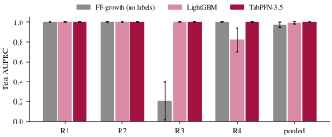
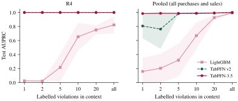
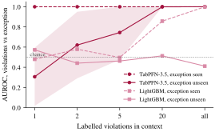

# Rule Mining, Gradient Boosting and Tabular In-Context Learning for Error Detection in Accounting Entries

A controlled study of what explicit frequent-itemset mining, gradient-boosted trees and a tabular foundation model (TabPFN) each detect in accounting entries, on synthetic French general ledgers with planted rules, planted violations and planted exceptions.

## Abstract

We generate synthetic general ledgers in the legal French FEC format and plant four rules: two account co-occurrence rules (R1, R2), a numeric threshold (R3) and a co-occurrence rule whose account marginals carry no signal (R4). FP-growth recovers every co-occurrence rule exactly and detects their violations without a single label (AUPRC 1.000), but cannot express the threshold (AUPRC 0.045 to 0.204) and ranks rare correct entries above errors. With labels, LightGBM and TabPFN both learn the threshold. On R4, TabPFN reaches 1.000 with a single labelled violation in context, where LightGBM needs about 20 to pass 0.75. A one-shot diagnostic and a second generator with rare valid patterns qualify this result: new accounts and new combinations are not mistaken for errors, but a valid exception that looks exactly like a violation and was never seen in context (reverse charge on a non-deductible expense) is ranked **above** real violations with one label (AUROC 0.306) and only separated from them after about 20 labelled violations. LightGBM never separates it, even with all labels (0.411).

## 1. Setup

**Data.** Each dataset is 40 companies over one year (about 43,000 entries, 109,000 FEC lines; one tab-separated FEC file per company, 18 legal columns, accounts from the French chart of accounts). Entries come from templates: purchase, sale, supplier payment, customer receipt, payroll, fixed asset. Every entry balances. Suppliers have a VAT regime and a country.

**Planted rules and violations.**

| Rule | Statement | What it tests |
|---|---|---|
| R1 | Purchases book deductible VAT on 44566, sales collected VAT on 44571 | Easy co-occurrence, high support |
| R2 | A supplier under VAT exemption (*franchise en base*) never comes with a 44566 line | Account × attribute |
| R3 | A durable purchase over 500 EUR excl. VAT goes to fixed assets (2183/2184 + 44562 / 404) | Numeric threshold, low support |
| R4 | An intra-EU purchase carries both 4452 and 44566, or neither | Co-occurrence with controlled marginals |

Violations are injected per rule at 0.5%, 2% or 5% of eligible entries. For R4 the valid entries are split 50/50 between "both" and "neither" and the violations 50/50 between the two single legs, so P(4452) and P(44566) are equal in valid and invalid entries (measured: 0.514 vs 0.488 and 0.514 vs 0.512). Labels are re-derived from the FEC lines by an independent oracle; every dataset passes all checks.

**Rare valid patterns** (second generator, `--rare`, off by default and then byte-identical to the first): a share of valid purchases becomes an invoice split over two expense accounts (`multi_expense`), a discount on its own 609 line (`discount_609`), or a reverse charge on non-deductible receptions (`eu_non_deductible`: 6257 + 4452 without 44566). The last one is identical to an R4 violation in account presence; only the 6257 account tells it apart, and R4 now carries this exception.

**Methods.**
- *FP-growth* (mlxtend 0.25), no labels. Items: accounts present, VAT accounts absent, journal, supplier type, a durable flag, total amount in fixed bins that do not align with the R3 threshold. Rules mined on the training companies; an entry is scored by the confidence of the strongest rule it breaks (confidence ≥ 0.9, lift ≥ 1.1).
- *LightGBM*, 300 trees, learning rate 0.05, `min_child_samples=1` so that it can learn from a handful of positives.
- *TabPFN* 10.2 with v2 weights and TabPFN-3.5 weights, default settings, Apple MPS.
- Two feature sets: **presence** (one column per account, journal, supplier type, durable flag, log total) and **amounts** (presence plus each account's signed share of the total).

**Protocol.** Companies are split in two halves; rules and models only see the training half. The context holds at most 3,000 training entries; with `k`, at most k labelled violations (all valid entries keep their label). Tasks: one per rule (entries eligible for the rule) and **pooled** (all purchases and sales, label = breaks any rule). Main metric AUPRC (low prevalence), mean ± standard deviation over 5 seeds. For rare patterns, AUROC of violations against each pattern: 0.5 is chance, below 0.5 means the valid pattern scores higher than real errors.

## 2. Results

### 2.1 Mining finds co-occurrence, not thresholds

Rule recovery, 15 datasets: R1, R2 and both halves of R4 are mined exactly at every minimum support below their own support (about 2.5% for R4), with confidence equal to one minus the violation rate. R3 is never mined from causes: the only rule found, `{durable, total 1k-3k EUR} → 44562`, covers part of the range; the threshold (600 EUR incl. VAT) falls inside the 300-1k bin, where the best rule has confidence 0.53. A first check that accepted any antecedent counted rules such as `{2183, durable} → 44562` as recovery; these start from the outcome and are excluded.

<p align="center"></p>

*Figure 1. Test AUPRC with all labels, violation rate 2%, presence features. Bars: mean; whiskers: one standard deviation over 5 seeds.*

On R3 the mining score is inverted at a 5% violation rate (AUPRC 0.045, AUROC 0.000): an expensed durable purchase looks like any purchase and breaks no rule, while a correctly capitalised one uses 404 instead of 401 and breaks the generic rule `{journal HA} → 401` (confidence 0.97). Frequency-based scoring treats rarity as error.

### 2.2 TabPFN needs one label where LightGBM needs twenty

<p align="center"></p>

*Figure 2. Test AUPRC against the number of labelled violations in context, violation rate 2%, presence features. Bands: one standard deviation.*

| Task, rate 2% | k = 1 | 2 | 5 | 10 | 20 | all |
|---|---|---|---|---|---|---|
| R4, LightGBM | 0.024 | 0.021 | 0.216 ± 0.197 | 0.654 ± 0.201 | 0.751 ± 0.064 | 0.823 ± 0.121 |
| R4, TabPFN v2 and 3.5 | 1.000 | 1.000 | 1.000 | 1.000 | 1.000 | 1.000 |
| Pooled, LightGBM | 0.158 ± 0.195 | 0.203 ± 0.206 | 0.319 ± 0.236 | 0.669 ± 0.190 | 0.927 ± 0.037 | 0.993 ± 0.013 |
| Pooled, TabPFN v2 | 0.807 ± 0.178 | 0.763 ± 0.281 | 0.984 ± 0.007 | 0.988 ± 0.009 | 0.992 ± 0.009 | 1.000 |
| Pooled, TabPFN-3.5 | 0.985 ± 0.009 | 0.988 ± 0.012 | 0.988 ± 0.010 | 0.988 ± 0.007 | 0.993 ± 0.008 | 1.000 |

R3 is at 1.000 for both supervised models from k = 1. With amount features, R4 is trivial for every method: a balanced entry with one VAT leg cannot have the supplier line equal to the expense line (ratio 1.000 in all 2,272 valid entries of one dataset, 1.200 or 0.833 in all 41 violations).

**Why one label suffices on R4** (`scripts/r4_one_shot_check.py`). The context holds exactly one violation ("44566 only") among 1,081 entries. Shuffling the context labels drops AUPRC to 0.131 (prevalence 0.058), so there is no leak. Valid entries score 0.000 to 0.002; violations of the seen type 0.55 to 0.94; violations of the **unseen** type ("4452 only") 0.05 to 0.13, above every valid entry. TabPFN does not learn "exactly one of the two" from one example: it gives probability mass to combinations absent from the labelled valid entries. In this generator, those are only violations.

### 2.3 The trap is an unseen exception that looks like an error

<p align="center"></p>

*Figure 3. AUROC of R4 violations against the non-deductible reverse charge, rare-pattern rate 2%, presence features. "Seen": the exception appears in the context like any valid entry. "Unseen": it is removed from the context and from mining, so it is new at test time. Band: one standard deviation (TabPFN, unseen).*

| AUROC, violations vs pattern, rare rate 2% | k = 1 | 2 | 5 | 20 | all |
|---|---|---|---|---|---|
| R4, `eu_non_deductible`, TabPFN-3.5, seen | 1.000 | 1.000 | 1.000 | 1.000 | 1.000 |
| R4, `eu_non_deductible`, TabPFN-3.5, unseen | 0.306 ± 0.288 | 0.620 ± 0.330 | 0.745 ± 0.269 | 0.999 | 1.000 |
| R4, `eu_non_deductible`, LightGBM, unseen | 0.572 ± 0.174 | 0.441 ± 0.130 | 0.462 ± 0.278 | 0.513 ± 0.203 | 0.411 ± 0.135 |
| Pooled, `discount_609`, TabPFN-3.5, unseen | 0.997 | 0.998 | 1.000 | 1.000 | 1.000 |
| Pooled, `multi_expense`, TabPFN-3.5, unseen | 0.971 ± 0.006 | 0.974 ± 0.012 | 0.982 ± 0.006 | 0.982 ± 0.008 | 1.000 |

- Novelty alone is not flagged: a new account or a new combination stays below violations from k = 1.
- An unseen exception that mimics a violation is ranked above real violations with one label, and is separated from them only once about 20 labelled violations show what the error actually is (one VAT leg with a standard expense account). At a rare rate of 0.5% the unseen curve is 0.648, 0.727, 0.794, 1.000, 1.000.
- LightGBM cannot use a column that never varied in training: with all labels it falls from 0.999 (seen) to 0.411 (unseen).
- FP-growth holds on R4 (0.966 unseen) but drops to 0.587 on the pooled task.

## 3. Limitations

One generator, simple rules, 40 companies per dataset, 5 seeds. Rules are deterministic and labels are exact; real ledgers have ambiguous rules and noisy labels. The feature sets are hand-built from the FEC lines; text fields (entry labels) are unused. No method is tuned. TabPFN-3.5 weights are under a non-commercial licence; the v2 weights (Apache 2.0 with attribution) give the same conclusions except at k ≤ 2 on the pooled task. On Apple MPS, the pooled task (about 12,000 test rows) needs chunked prediction.

## 4. Practical reading

- Co-occurrence rules between accounts: mine them, no labels needed, and keep the rules readable.
- Thresholds and conditions on amounts: a supervised model with labels.
- Few labels: TabPFN is far more label-efficient than gradient boosting, but known exceptions to a rule must be present in its context, even as a handful of examples. A confidence threshold does not catch an exception the model has never seen: it is confidently wrong.

## Reproducibility

```sh
make setup test
make data           # 25 datasets, about 400 MB, each validated by the oracle
make phase1         # FP-growth
cp .env.example .env    # TABPFN_TOKEN=..., accept the TabPFN-3.5 licence at ux.priorlabs.ai
make phase2 phase2b phase2c   # several hours on Apple MPS
make report figures # results/summary.md, figures/
```

LightGBM and TabPFN run in separate processes: in one process on macOS their two OpenMP runtimes deadlock. Every number in this README is in `results/summary.md`, produced by `ledger.report` from the raw results in `results/*.jsonl`.

| Path | Content |
|---|---|
| `src/ledger/generate.py` | Synthetic FEC ledgers, planted rules, violations and rare valid patterns |
| `src/ledger/validate.py` | Format checks and independent label oracle |
| `src/ledger/mining.py` | FP-growth rule recovery and rule-based detection |
| `src/ledger/supervised.py` | Features, context sampling, LightGBM and TabPFN, metrics |
| `src/ledger/report.py`, `figures.py` | Tables and figures |
| `scripts/` | Grids per phase, one-shot diagnostic |
| `tests/` | Generator, oracle and mining tests |

## References

- Han, Pei, Yin. *Mining Frequent Patterns without Candidate Generation*. SIGMOD 2000.
- Raschka. *MLxtend: Providing machine learning and data science utilities and extensions to Python's scientific computing stack*. JOSS 2018.
- Hollmann, Müller, Eggensperger, Hutter. *TabPFN: A Transformer That Solves Small Tabular Classification Problems in a Second*. ICLR 2023, arXiv:2207.01848.
- Hollmann et al. *Accurate predictions on small data with a tabular foundation model*. Nature 2025.

Code released under the MIT license. TabPFN weights are subject to their own licences.
